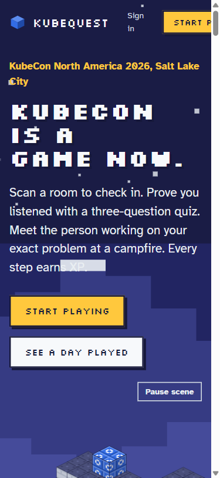
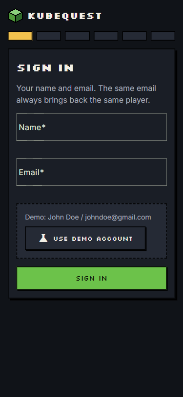
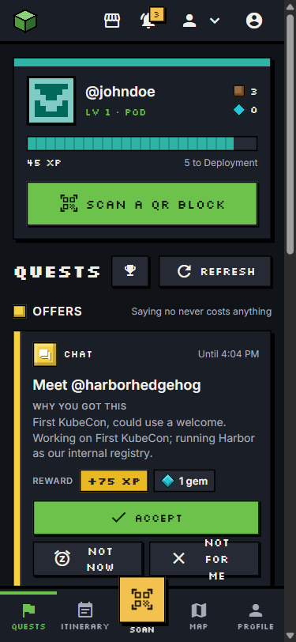
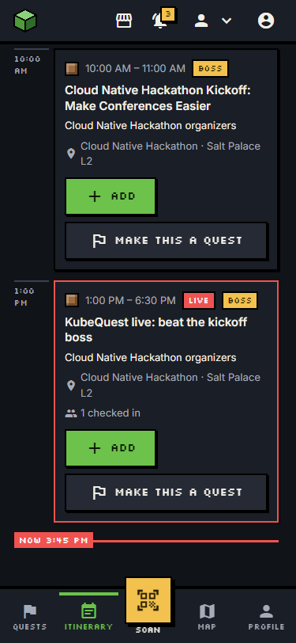
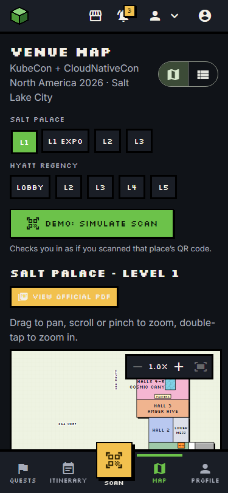
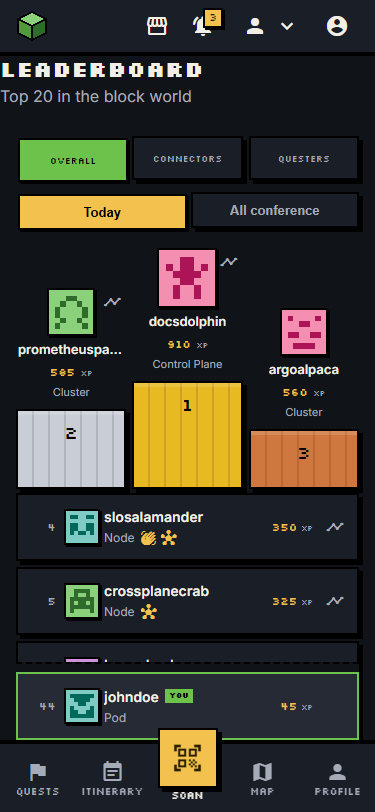

# KubeQuest

**KubeCon is a game now.** KubeQuest turns the conference into a block world. Every room, booth and campfire is a place you check in to. Quests tell you which talk to catch, which booth to visit and who to meet. You earn XP and blocks for showing up (signed QR check-ins), for listening (a three-question quiz on the talk) and for meeting people (a mutual opt-in Hallway meet at a campfire, confirmed by both sides). Every point is traceable to the request that awarded it.

| | |
|---|---|
| **Live** | https://kube-quest.cnh.radarhq.io |
| **Demo account** | Name `John Doe`, email `johndoe@gmail.com`, or tap **Use demo account** on the sign-in screen |
| **Built for** | WeMakeDevs Cloud Native Hackathon, KubeCon + CloudNativeCon NA 2026, Salt Lake City (Nov 9 2026) |
| **Stack** | Angular 21 + Express (TypeScript) in one image, Elastic Cloud Serverless, OpenTelemetry to Dash0, Argo CD on a Radar vcluster, Gitar review |

<p>
  
  
  
</p>
<p>
  
  
  
</p>

## 3-minute demo script

| Time | Step | What it shows |
|------|------|---------------|
| 0:00 | **Scan the projector QR.** The boss room's screen (`/screen/:locationId`) shows a QR with a 10-minute signed check-in token. Scan it with a phone. | Signed HMAC tokens, no remote check-ins |
| 0:20 | **Sign in.** Tap **Use demo account** (John Doe). The check-in lands: +XP and a block. | Same email always brings back the same player |
| 0:40 | **Boss quiz.** Answer the three questions on the kickoff talk. The shared boss health bar drops for everyone. | Quiz answers stay on the server; health is an Elastic aggregation |
| 1:10 | **People and meet.** Open People: matches ranked by RRF hybrid search over what each person typed at sign-up. Accept a meet: both sides opt in, the game picks the campfire closest to both by `geo_distance` and gives an icebreaker. | Hallway matching, mutual opt-in |
| 1:40 | **Leaderboard.** Overall, Connectors and Questers boards. | Elastic aggregations over `xp_events` |
| 1:55 | **Open the trace in Dash0.** Every XP event carries the `traceId` of the request that awarded it. Open it: browser → API → `tool.check_in` → Elasticsearch. | Observability as a game feature |
| 2:20 | **Map + simulate scan.** Venue map of the Salt Palace and Hyatt, pan and zoom, then **Demo: simulate scan** to check in to a booth without walking there. | Geo points, real venue data |
| 2:35 | **Itinerary.** Today's schedule with a "now" line, add a talk to the plan, or turn a talk into a quest. | Personal plan and schedule tools |
| 2:50 | **Recap PDF.** Open Recap and save the day as a PDF: talks with quiz scores, people met, booth notes and a next step for each. | The takeaway after the conference |

## Features

- **Quests:** a quest board of offers (talks, booths, people) you accept, snooze or decline; quests complete from real events.
- **Signed check-ins:** QR codes per room, booth and campfire, signed with HMAC; one scan per place per hour; a projector screen shows a QR with a 10-minute signed token.
- **Talk quizzes:** three questions per talk, written ahead of time by the Agent Builder `kubequest-writer` agent and stored on the talk, so the demo never waits on a model.
- **Community boss:** a live session whose health bar drops with every correct answer from every player, with a defeat bonus paid exactly once.
- **Hallway meets:** people matching by hybrid search, mutual opt-in, a time slot, the nearest campfire to both players, an icebreaker, and a confirmed handshake for +XP and a gem.
- **People and connections:** who is here now, profile links, saved connections and messages.
- **Itinerary:** the conference schedule, a personal plan and "make this a quest".
- **Venue map:** the Salt Palace and Hyatt Regency floors with pan and zoom, booth photos and a demo "simulate scan".
- **Leaderboards, levels and banners:** Pod → Deployment → Node → Cluster → Control Plane, blocks by material, and banners for sets (Observability Nerd, Connector, Welcomer).
- **Notifications:** an in-app bell plus a nudge CronJob.
- **Role views:** attendee, exhibitor (a page and dashboard per booth, with notes) and organizer (meet funnel and stats).
- **Recap PDF** of your day.

## Architecture

```
  phone / browser           projector screen         Agent Builder        CronJob (nudge)
        |                         |                        |                    |
        v                         v                        v                    v
 +------------------------------------------------------------------------------------------+
 | Node image  (vcluster kube-quest / namespace team-kube-quest / Deployment app, Service :80) |
 |                                                                                          |
 |   Angular 21 SPA  ->  Express: /api/tools/:name  /r/:locationId  /api/screen-token/:id   |
 |                              |                                                           |
 |                              v                                                           |
 |   app/src/tools/*.tool.ts   the only code that touches data; no model inside; 1 span each |
 |        |                 |                                                               |
 |        |                 +-- xp/award.ts  (only writer to xp_events, stores traceId)      |
 |        v                                                                                 |
 |   es/client.ts (timeout on every call)          otel.ts (traces, metrics, logs)          |
 +--------|--------------------------------------------------|------------------------------+
          |                                                  |  OTLP/HTTP
          v                                                  v
  Elastic Cloud Serverless                         OpenTelemetry Collector (deploy/)
   - semantic_text (Jina v5)                                 |
   - rrf hybrid retriever                                    v
   - geo_distance campfires                                Dash0  (traces, metrics, logs, SLO)
   - aggregations (boards, boss health, funnel)
   - Agent Builder: kubequest-writer
   - Workflow: kubequest-banners

  GitHub PR (Gitar review) -> merge main -> Action builds GHCR image -> deploy commit
        -> Argo CD in vcluster kube-quest syncs deploy/  (observed and operated with Radar)
```

More: [`docs/architecture.md`](docs/architecture.md), [`docs/api.md`](docs/api.md), [`docs/elastic.md`](docs/elastic.md).

## Sponsor tools

The detailed write-up, including what is still missing, is in [`docs/sponsor-tools.md`](docs/sponsor-tools.md).

### Elastic: the only datastore and the matching engine

- **No other database.** Elastic Cloud Serverless holds everything: `talks`, `attendees`, `locations`, `xp_events`, `intros`, `quests` and the rest.
- **`semantic_text` with Jina embeddings** (`.jina-embeddings-v5-text-small`) on talks and player profiles.
- **Hybrid search with the `rrf` retriever:** a BM25 `multi_match` and a semantic retriever fused by reciprocal rank fusion. It powers `search`, `recommend_talks` and `recommend_people`. In the seed data, the two demo players rank each other first purely from what they typed at sign-up.
- **`geo_distance`:** every room, booth and campfire is a `geo_point`; a meet picks the campfire nearest the midpoint of both players.
- **Aggregations** for the three leaderboards, the boss's shared health bar, room busyness and the organizer's meet funnel.
- **Agent Builder as the model layer:** the `kubequest-writer` agent wrote validated three-question quizzes for every talk, stored on the talk.
- **Elastic Workflow `kubequest-banners`** ([`resources/workflows/banners.yaml`](resources/workflows/banners.yaml)) awards banners with the same deterministic badge ids as the app, so the two can run side by side. It is created in Kibana and an execution completed green (PR #15).

### Dash0: every XP point is traceable

- **OpenTelemetry Node SDK** (`app/src/otel.ts`, loaded before the app) for traces, metrics and logs.
- **An in-namespace OpenTelemetry Collector** with its config in git ([`deploy/otel-collector.yaml`](deploy/otel-collector.yaml)): `memory_limiter`, `batch` and resource attributes, exporting to Dash0. The token lives only in the `app-credentials` Secret.
- **A span per tool** (`tool.<name>`) with our own `kubequest.*` attributes (`kubequest.tool`, `kubequest.location.id`, `kubequest.xp.awarded`, the rejection reason, ...), plus HTTP and Elasticsearch auto-instrumentation.
- **Metrics:** `kubequest.xp.awarded`, `kubequest.checkins`, `kubequest.handshakes`, `kubequest.quiz.duration`.
- **Trace ids on every XP event:** `awardXp` stores the active `traceId` in `xp_events`, so any point on the leaderboard opens the request that awarded it. JSON logs carry `trace_id` and `span_id`.
- **SLO "KubeQuest API availability"**, created in Dash0 with Agent0.

### Radar: the cluster, run through an agent

- **Our own vcluster `kube-quest`** (namespace `team-kube-quest`), public at https://kube-quest.cnh.radarhq.io.
- **GitOps with Argo CD:** merge to `main` → the GitHub Action builds the image → a `deploy: <sha>` commit → Argo CD syncs `deploy/` (app, Service, collector, nudge CronJob).
- **The Radar MCP server from Claude Code** created and extended the `app-credentials` Secret outside git (reading the live Secret first, never echoing values), synced Argo CD, watched rollouts and read pod logs and events. Radar's pod logs found our Dash0 auth error ("invalid authentication token starting with 'missing'").
- **The Radar Cloud UI** applied the Argo CD Application after we reviewed its dry-run diff.
- When our first cluster failed to provision, Radar's join status showed it and we recreated the team as `kube-quest`.
- Every step, with times and revisions: [`docs/radar-log.md`](docs/radar-log.md).

### Gitar: every change through review

- **Every change lands through a PR** that Gitar reviews; only the deploy bot commits to `main` directly.
- **Project rules in [`.gitar/`](.gitar):** review instructions ([`conventions.md`](.gitar/review/conventions.md), [`security.md`](.gitar/review/security.md)), repository rules ([`game-integrity.md`](.gitar/rules/game-integrity.md), [`ai-disclosure.md`](.gitar/rules/ai-disclosure.md)) and auto-apply criteria ([`apply.md`](.gitar/config/apply.md)). They encode the game's integrity: signed check-ins, `awardXp` as the only XP writer, nothing revealing before a mutual accept, a timeout on every Elasticsearch call, no model inside a tool.
- **Real findings, fixed.** On PR #3 Gitar caught a `check_in` that paid on every call and a quiz that leaked its answers; backend v1 fixed both. On PR #5 it found three more, all fixed in **PR #15**:
  1. **Security:** the screen-token endpoint minted check-in tokens for anyone. Minting now needs a per-location display key, compared in constant time, and `screen_token` is blocked on the public tools router.
  2. **Bug:** the boss defeat bonus could pay twice under concurrent polls. It is now written once with a deterministic id, create-only.
  3. **Rule:** `claimQuiz` wrote to `xp_events` outside `award.ts`. It now goes through `award.ts`.

## Run it locally

Requirements: Node 22 and an Elastic Cloud Serverless project.

```bash
npm ci
```

Create `.env` in the repo root (gitignored, never commit it):

| Key | What it is |
|-----|-----------|
| `ELASTIC_URL` | Elasticsearch endpoint of the Serverless project |
| `ELASTIC_API_KEY` | API key with read and write on the KubeQuest indices |
| `ELASTIC_INFERENCE_ID` | Embedding endpoint for `semantic_text` (default `.jina-embeddings-v5-text-small`) |
| `KIBANA_URL`, `ELASTIC_AGENT_ID` | Agent Builder (optional) |
| `QR_SECRET` | HMAC key that signs check-in QR tokens |
| `OTEL_EXPORTER_OTLP_ENDPOINT` | OTLP endpoint (optional locally) |

Create the indices, load the seed data and the demo login, then start the API and the web app:

```bash
npm run index-all
npm run seed:demo
npm run dev
```

The API listens on http://localhost:8080 (`GET /healthz`, `GET /api/tools`). For a production-like run, `npm run build` and `node app/dist/server.js`, which serves the web build from `PUBLIC_DIR`. Operations, secrets and QR printing: [`docs/ops.md`](docs/ops.md).

## AI disclosure

KubeQuest was built with **Claude Code** (Anthropic), with several agent sessions working in parallel lanes. Every change landed through a pull request reviewed by Gitar and the team. Inside the game, models run only through Elastic (Agent Builder), never inside the tools that award XP; quizzes were generated ahead of time and validated before they were stored.

## License

See [LICENSE](LICENSE).
